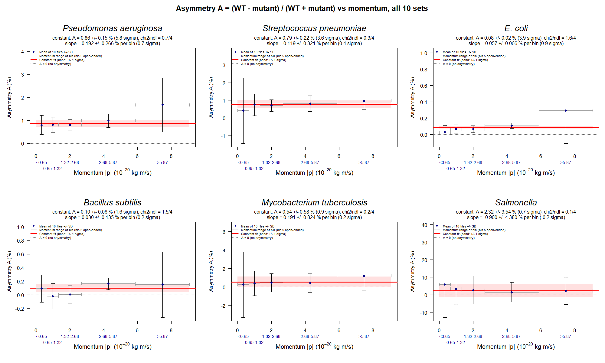

# PRA2003 – Bacteria per event and WT–mutant asymmetry (Group R2)

Counting bacterial strains per event in a sample of 5M events, and testing
whether each normal (wild-type, WT) strain occurs as often as its mutant,
overall and as a function of momentum. All uncertainties come from the
**sub-sampling method** from the lecture.

## Contents

1. [Overview and answer](#1-overview-and-answer)
2. [Files](#2-files)
3. [How to run](#3-how-to-run)
4. [The data](#4-the-data)
5. [Method](#5-method)
6. [Results](#6-results)
7. [Conclusion: do we see an asymmetry?](#7-conclusion-do-we-see-an-asymmetry)
8. [Notes and limitations](#8-notes-and-limitations)

---

## 1. Overview and answer

Each strain appears as a normal (wild-type) form with a positive ID and a
mutant form with the same ID and a minus sign (for example E. coli WT = 211
and E. coli mutant = -211). The three questions are:

1. What is the **average number of each strain per event**, and its
   statistical uncertainty? (Section 6.1)
2. Is there an **asymmetry** between the WT and the mutant? (Sections 6.2, 6.3)
3. Does the asymmetry depend on **momentum**? (Section 6.4)

Our group (R2) was assigned the pairs 2212/-2212 (*Pseudomonas aeruginosa*)
and 3122/-3122 (*Streptococcus pneumoniae*). The analysis covers all six
WT/mutant pairs.

**Short answer.** Yes, there is an asymmetry for three of the six pairs, and
in all of them the wild type is the more common form:

| Pair | Asymmetry A | Significance |
|---|---:|---:|
| 2212 / -2212 *P. aeruginosa* (assigned) | (1.00 ± 0.10)% | 10.0σ |
| 3122 / -3122 *S. pneumoniae* (assigned) | (0.89 ± 0.11)% | 8.4σ |
| 211 / -211 *E. coli* | (0.081 ± 0.011)% | 7.2σ |

The other three pairs (*B. subtilis*, *M. tuberculosis*, *Salmonella*) are
consistent with no asymmetry. For none of the six pairs does the asymmetry
depend significantly on momentum (all slopes are below 1σ).

## 2. Files

| File | Purpose |
|---|---|
| `README.md` | Current file |
| `Week4Sub_Sampling.R` | Counts every ID in each of the 10 data files (the 10 sub-samples) and writes `sub_sample_results.csv` |
| `Week4Analysis.R` | Reads that csv and computes the average per event and its uncertainty for every ID |
| `Week5_Momentum_Analysis.R` | Asymmetry per pair, overall and in 5 momentum bins, with fits and the plot |
| `sub_sample_results.csv` | Output of `Week4Sub_Sampling.R`: count and average per ID for each file |
| `final_results.csv` | Output of `Week4Analysis.R`: final average ± uncertainty per ID |
| `momentum_perfile_results.csv` | Output of `Week5_Momentum_Analysis.R`: counts per file, pair and momentum bin (saved so the raw data need not be read again) |
| `momentum_bin_edges.csv` | The edges of the 5 momentum bins |
| `overall_asymmetry.csv` | Overall difference per event and asymmetry per pair |
| `asymmetry_per_bin.csv` | Asymmetry per pair and momentum bin |
| `momentum_fits.csv` | Constant fit and slope per pair |
| `asymmetry_vs_momentum.png` | The plot of Section 6.4 |

The raw data files (`output-Set1.txt` … `output-Set10.txt`, about 800 MB
each) are **not** included in the repository due to their size. They can be
downloaded here --> https://surfdrive.surf.nl/files/index.php/s/7udCnWTk4yMUASD.

## 3. How to run

1. Put the 10 raw data files in a folder called `DataFiles` next to the scripts.
2. Run `Week4Sub_Sampling.R` (VS Code: Run Code, Ctrl + Alt + N). This reads
   the raw data and writes `sub_sample_results.csv`.
3. Run `Week4Analysis.R`. This reads `sub_sample_results.csv` and writes
   `final_results.csv`.
4. Run `Week5_Momentum_Analysis.R` (for example `Rscript Week5_Momentum_Analysis.R`).
   It needs `sub_sample_results.csv` (for the number of events per file).
   The first run reads the raw data (about 20 minutes) and saves the counts
   in `momentum_perfile_results.csv` and `momentum_bin_edges.csv`. Later runs
   use these two files and take a few seconds. Delete them to recount.
   It writes the three csv files and the png listed in Section 2.

Steps 3 and 4 only need the csv files, so the final results can be
reproduced without the raw data once the csv files exist.

## 4. The data

- 10 files, each containing about 500K events (5M events in total).
- Each event starts with a header line (event number and number of
  bacteria), followed by one line per bacterium: three momentum components
  (px, py, pz) and the bacterial ID.
- Empty events (0 bacteria) are excluded from the averages.
- The IDs of the 12 strains of interest are:

| ID | Strain | ID | Strain |
|---:|---|---:|---|
| 211 | E. coli WT | -211 | E. coli mutant |
| 321 | Bacillus subtilis WT | -321 | Bacillus subtilis mutant |
| 2212 | Pseudomonas aeruginosa WT | -2212 | Pseudomonas aeruginosa antibiotic-resistant |
| 3122 | Streptococcus pneumoniae | -3122 | Capsule-deficient S. pneumoniae |
| 3312 | Mycobacterium tuberculosis | -3312 | Drug-resistant M. tuberculosis |
| 3334 | Salmonella enterica | -3334 | Salmonella mutant |

The data contain further IDs that are not one of these 12 strains. They
appear as "Unknown" in `final_results.csv` and are not part of the results
below, except for the 12 extra pairs of Section 6.3.

## 5. Method

### 5.1 Sub-sampling (average per event and uncertainty)

1. **Split** the sample into 10 sub-samples of similar size. Each data file
   (about 500K events) is one sub-sample.
2. **Analyse each sub-sample separately:** for every ID, compute the average
   number per event in that file.
3. **Central value (Section 6.1):** the inverse-variance weighted average of
   the 10 sub-sample results (weight = 1 / uncertainty² per sub-sample).
4. **Statistical uncertainty:** the standard deviation of the 10 sub-sample
   results.

The standard deviation describes how much the result varies from one
sub-sample of about 500K events to another. Only the statistical uncertainty
is quoted. No systematic uncertainty was evaluated, and since the result is
a number per event, it has no unit.

### 5.2 Asymmetry between WT and mutant

For each pair, two quantities are calculated **in each of the 10 files
first**:

- the difference per event: D = (N_WT − N_mutant) / number of events
- the asymmetry: A = (N_WT − N_mutant) / (N_WT + N_mutant), given in %

The reported value is the **mean over the 10 files** and its uncertainty is
the **standard deviation over the 10 files**. The significance is
value / uncertainty, and an asymmetry is called **significant if it is at
least 3σ**.

Taking the difference within each file first (instead of combining the
finished uncertainties of WT and mutant in quadrature) is deliberate: WT and
mutant are counted in the same events, so a file with more bacteria tends to
have more of both. This shared fluctuation cancels in the per-file
difference, while quadrature would wrongly treat the two as independent.
Note that the central values in Section 6.1 are weighted means, while the
asymmetries here are plain means of the per-file values.

### 5.3 Asymmetry as a function of momentum

1. The momentum of each bacterium is |p| = √(px² + py² + pz²).
2. The momentum range is divided into **5 bins**, each holding about 20% of
   the bacteria of Set 1 (quantiles of Set 1). The same edges are used for
   all 10 files. The first and last bin are open-ended, so every bacterium
   is counted. Because the bins are quantiles, their widths grow roughly
   by a factor 2 from one bin to the next.
3. In each file and each bin, the asymmetry A is calculated. The point of a
   bin is the mean over the 10 files and its error bar is the standard
   deviation over the 10 files.
4. Two checks of whether A depends on momentum:
   - **Constant fit.** The weighted mean of the 5 bins (weights 1/σ²) with
     its uncertainty 1/√(Σ 1/σ²), and χ²/ndf with ndf = 4. A χ² close to or
     below ndf means a constant describes the 5 bins well.
   - **Slope.** A straight line A = a + s · (bin number) is fitted through
     the 5 bins of **each file**; the result is the mean slope ± the
     standard deviation of the 10 slopes. A slope is significant if
     slope / uncertainty ≥ 3. The slope is in % per bin number (the last bin
     has no upper edge, so a slope per unit of momentum is not defined).

## 6. Results

### 6.1 Average count per event (5M events, 10 sub-samples)

| ID | Strain | Total count | Average / event | Uncertainty |
|---:|---|---:|---:|---:|
| 211 | E. coli WT | 92,126,688 | 19.9495 | ± 0.0327 |
| -211 | E. coli mutant | 91,977,542 | 19.9172 | ± 0.0319 |
| 321 | Bacillus subtilis WT | 11,587,227 | 2.50915 | ± 0.00477 |
| -321 | Bacillus subtilis mutant | 11,560,946 | 2.50346 | ± 0.00550 |
| 2212 | Pseudomonas aeruginosa WT | 5,578,693 | 1.20803 | ± 0.00190 |
| -2212 | P. aeruginosa antibiotic-resistant | 5,468,447 | 1.18416 | ± 0.00241 |
| 3122 | Streptococcus pneumoniae | 1,277,330 | 0.276599 | ± 0.00107 |
| -3122 | Capsule-deficient S. pneumoniae | 1,254,690 | 0.271696 | ± 0.000985 |
| 3312 | Mycobacterium tuberculosis | 182,139 | 0.0394412 | ± 0.000284 |
| -3312 | Drug-resistant M. tuberculosis | 180,104 | 0.0390005 | ± 0.000402 |
| 3334 | Salmonella enterica | 5,482 | 0.00118710 | ± 0.0000417 |
| -3334 | Salmonella mutant | 5,318 | 0.00115158 | ± 0.0000508 |

The data also contain 26 other IDs that are not one of the 12 strains. They
are listed as "Unknown" in `final_results.csv`.

### 6.2 Asymmetry: wild type vs mutant

Calculated as described in Section 5.2 (`overall_asymmetry.csv`).

| Pair | D = X − (−X) per event | nσ | Asymmetry A | Asymmetric? |
|---|---:|---:|---:|:---:|
| 2212 vs -2212 (P. aeruginosa) | 0.02387 ± 0.00237 | **10.06** | **(1.00 ± 0.10)%** | **yes** |
| 3122 vs -3122 (S. pneumoniae) | 0.00490 ± 0.00058 | **8.41** | **(0.89 ± 0.11)%** | **yes** |
| 211 vs -211 (E. coli) | 0.0323 ± 0.0045 | **7.15** | **(0.08 ± 0.01)%** | **yes** |
| 321 vs -321 (B. subtilis) | 0.00569 ± 0.00329 | 1.73 | (0.11 ± 0.07)% | no |
| 3312 vs -3312 (M. tuberculosis) | 0.00044 ± 0.00049 | 0.90 | (0.56 ± 0.62)% | no |
| 3334 vs -3334 (Salmonella) | 0.000036 ± 0.000069 | 0.52 | (1.5 ± 2.9)% | no |

The averages of X and -X are in Section 6.1.

#### The answer for each pair, and why

- **2212 vs -2212, *P. aeruginosa*: yes, a clear asymmetry.** The wild type is
  0.0239 per event more common than the antibiotic-resistant strain, which
  is 10.06σ, far above the 3σ threshold. A = (1.00 ± 0.10)%.
- **3122 vs -3122, *S. pneumoniae*: yes, an asymmetry.** The wild type is more
  common than the capsule-deficient strain by 8.41σ. A = (0.89 ± 0.11)%.
- **211 vs -211, *E. coli*: yes, a significant asymmetry.** The WT is 0.0323
  per event more common, a 7.15σ effect. A = (0.08 ± 0.01)% is small in
  absolute terms, but measured precisely because E. coli is so abundant.
- **321 vs -321, *B. subtilis*: no asymmetry.** The difference is 1.73σ, and
  A = (0.11 ± 0.07)% is consistent with zero.
- **3312 vs -3312, *M. tuberculosis*: no asymmetry.** The difference is
  0.90σ. With about 180,000 counts per strain, the data can only rule out
  asymmetries larger than about 2.4%.
- **3334 vs -3334, *Salmonella*: no asymmetry.** The difference is 0.52σ.
  With only about 5,400 counts per strain, A = (1.5 ± 2.9)% is very
  imprecise, so an asymmetry smaller than about 10% cannot be ruled out.

### 6.3 Asymmetry: the other 12 particle/antiparticle pairs

The same test applied to the 12 other pairs of IDs in the data:

| Pair | X − (−X) | nσ | Asymmetry A | Asymmetric? |
|---|---:|---:|---:|:---:|
| 3212 vs -3212 | 0.00173 ± 0.00076 | 2.26 | (0.57 ± 0.25)% | no |
| 3222 vs -3222 | 0.00173 ± 0.00059 | 2.93 | (0.58 ± 0.20)% | no |
| 3112 vs -3112 | 0.00202 ± 0.00046 | **4.43** | **(0.68 ± 0.15)%** | **yes** |
| 3322 vs -3322 | 0.00026 ± 0.00030 | 0.88 | (0.34 ± 0.39)% | no |
| 431 vs -431 | -0.00005 ± 0.00017 | 0.32 | (-0.23 ± 0.74)% | no |
| 531 vs -531 | 0.00002 ± 0.00008 | 0.32 | (1.3 ± 3.9)% | no |
| 4232 vs -4232 | 0.000003 ± 0.000033 | 0.09 | (0.2 ± 2.7)% | no |
| 4132 vs -4132 | 0.000008 ± 0.000041 | 0.19 | (0.7 ± 3.5)% | no |
| 5132 vs -5132 | 0.000014 ± 0.000020 | 0.70 | (14 ± 19)% | no |
| 5232 vs -5232 | -0.000002 ± 0.000016 | 0.14 | (-2 ± 15)% | no |
| 4332 vs -4332 | 0.000004 ± 0.000012 | 0.37 | (13 ± 36)% | no |
| 5332 vs -5332 | 0.0000006 ± 0.0000035 | 0.18 | (18 ± 86)% | no |

- **1 of the 12 pairs is above 3σ:** 3112 vs -3112, at 4.43σ, with
  A = (0.68 ± 0.15)%. 3222 (2.93σ) is close but does not cross the threshold.
- **The rarest pairs** (5132, 5232, 4332, 5332, with 7–260 counts each) have
  such large uncertainties that they cannot show anything either way.

### 6.4 Asymmetry as a function of momentum

**Figure 1.** Asymmetry A = (N_WT − N_mutant) / (N_WT + N_mutant) in % as a
function of momentum |p| (units 10⁻²⁰ kg m/s), one panel per pair, using all
10 data sets. Each point is the mean of the 10 files in one of 5 momentum
bins and is drawn at the centre of the bin; the vertical error bar is the
standard deviation over the 10 files, and the grey horizontal bar is the
range of the bin (the first bin starts at 0 and the last bin is open-ended,
drawn as wide as the one before it for display only). The red line is the
constant fit with its ±1σ band, the dotted line marks A = 0. Each panel has
its own y-axis. For *P. aeruginosa*, *S. pneumoniae* and *E. coli* the points
lie above zero in every bin and follow a flat line: the asymmetry is
present at all momenta but does not grow or shrink with momentum. For the
other three pairs the error bars are consistent with zero. The last bin has
the largest error bar for most pairs.

Asymmetry A (%) per momentum bin, mean ± standard deviation over the 10
files (`asymmetry_per_bin.csv`; momentum ranges in 10⁻²⁰ kg m/s):

| Pair | < 0.65 | 0.65 – 1.32 | 1.32 – 2.68 | 2.68 – 5.87 | > 5.87 |
|---|---:|---:|---:|---:|---:|
| *P. aeruginosa* | 0.80 ± 0.42 | 0.81 ± 0.33 | 0.80 ± 0.23 | 0.98 ± 0.30 | 1.67 ± 1.18 |
| *S. pneumoniae* | 0.42 ± 1.86 | 0.75 ± 0.61 | 0.70 ± 0.34 | 0.82 ± 0.45 | 0.98 ± 0.50 |
| *E. coli* | 0.029 ± 0.082 | 0.067 ± 0.052 | 0.066 ± 0.041 | 0.109 ± 0.032 | 0.29 ± 0.40 |
| *B. subtilis* | 0.09 ± 0.20 | −0.02 ± 0.19 | 0.005 ± 0.131 | 0.164 ± 0.086 | 0.15 ± 0.48 |
| *M. tuberculosis* | 0.26 ± 3.56 | 0.40 ± 1.34 | 0.47 ± 1.00 | 0.44 ± 1.03 | 1.20 ± 1.55 |
| *Salmonella* | 5.8 ± 18.7 | 3.3 ± 9.0 | 2.7 ± 8.0 | 1.5 ± 5.5 | 2.3 ± 7.8 |

Constant fit and slope (`momentum_fits.csv`; slope in % per bin number):

| Pair | Constant A (%) | Significance | χ²/ndf (p) | Slope (% per bin) | Slope significance |
|---|---:|---:|---:|---:|---:|
| *P. aeruginosa* | 0.86 ± 0.15 | 5.8σ | 0.7/4 (0.95) | 0.19 ± 0.27 | 0.7σ |
| *S. pneumoniae* | 0.79 ± 0.22 | 3.6σ | 0.3/4 (0.99) | 0.12 ± 0.32 | 0.4σ |
| *E. coli* | 0.084 ± 0.022 | 3.9σ | 1.6/4 (0.80) | 0.057 ± 0.066 | 0.9σ |
| *B. subtilis* | 0.10 ± 0.06 | 1.6σ | 1.5/4 (0.82) | 0.030 ± 0.135 | 0.2σ |
| *M. tuberculosis* | 0.54 ± 0.58 | 0.9σ | 0.2/4 (0.99) | 0.19 ± 0.82 | 0.2σ |
| *Salmonella* | 2.3 ± 3.5 | 0.7σ | 0.07/4 (1.00) | −0.9 ± 4.4 | −0.2σ |

- **No momentum dependence.** All six slopes are below 1σ (the largest is
  0.9σ, *E. coli*), far from the 3σ criterion. All χ²/ndf values are at or
  below 1.6/4, so a constant describes the 5 bins of every pair well.
- **The asymmetry is the same at all momenta.** For the three significant pairs
  the constant is positive and consistent with the overall values of
  Section 6.2. The constant fit is a weighted mean over the 5 bins, so its
  significance (for example 5.8σ for *P. aeruginosa*) is lower than the
  overall significance of Section 6.2 (10.0σ). The overall value is the
  headline number, the constant fit only tests whether A is flat.
- **Single bins.** Only three bins reach 3σ on their own: *P. aeruginosa*
  bins 3 and 4 (3.5σ, 3.3σ) and *E. coli* bin 4 (3.4σ). All lie in the
  middle of the momentum range where the uncertainties are smallest. The
  rare strains (*M. tuberculosis*, *Salmonella*) have too few bacteria per
  bin to show anything.
- **Relation to the presentation.** The presentation (slide 9) plotted the
  count difference N_WT − N_mutant per bin for E. coli and Salmonella, with
  slopes of 1.9σ and 0.1σ. Here the relative asymmetry is used for all six
  pairs. Both give the same conclusion: no significant momentum dependence.

## 7. Conclusion: do we see an asymmetry?

**Yes**, for three of the six WT/mutant pairs, and always with more wild type
than mutant:

- *Pseudomonas aeruginosa* (2212): A = (1.00 ± 0.10)%, 10.0σ
- *Streptococcus pneumoniae* (3122): A = (0.89 ± 0.11)%, 8.4σ
- *E. coli* (211): A = (0.081 ± 0.011)%, 7.2σ

All three are well above the 3σ threshold we use. Among the 12 additional
pairs of Section 6.3 only 3112/-3112 is above 3σ (4.4σ, A = 0.68%).

**No asymmetry is seen** for *B. subtilis* (1.7σ), *M. tuberculosis* (0.9σ)
and *Salmonella* (0.5σ). For *M. tuberculosis* and especially *Salmonella* the
result is limited by the number of bacteria, so small asymmetries (about 2%
and about 10%, respectively) cannot be excluded.

**The asymmetry does not depend on momentum.** For all six pairs the slope
is below 1σ and a constant asymmetry describes the data in the 5 momentum
bins well.

## 8. Notes and limitations

- **Meaning of the uncertainty.** The quoted uncertainty is the spread of
  one 500K-event sub-sample (standard deviation over the 10 files). The
  uncertainty of the average over all 10 sub-samples is smaller by a factor
  of about √10 (the standard error of the mean). Significances in Sections
  6.2 and 6.4 use the standard deviation, so they are conservative.
- **Statistical only.** No systematic uncertainty was estimated.
- **Wild type vs mutant.** The counts of a wild type and its mutant come from
  the same events and can be correlated, so the uncertainty on their
  difference is not obtained by adding the two uncertainties in quadrature.
  The difference and the asymmetry are computed within each sub-sample and
  the spread is taken over those values (Section 5.2).
- **Empty events.** Events with 0 bacteria were excluded from the event
  count used in the averages (though they were still scanned to check their
  header). Across the 10 sub-samples, 4,617,993 of the nominal 5,000,000
  events contained at least one bacterium and were used; the remaining
  382,007 events (about 7.6%) were empty and excluded. The number of events
  per file used in Section 6.2 is recovered as total count / average per
  event for E. coli WT, whose large average makes the rounding negligible.
- **Momentum bins.** The bin edges come from Set 1 only and are used for all
  files, so the bins hold about 20% of the bacteria each in Set 1 but not
  necessarily in the other files. The first and last bin are open-ended; the
  width of the last bin in Figure 1 is for display only. The slope is in %
  per bin number, not per unit of momentum.
- **Small χ² values.** The χ²/ndf of the constant fits are all below 1.6/4
  (p-values 0.80 – 1.00), meaning the bins scatter less than their error bars
  suggest. The error bars are therefore on the conservative side.
- **Large error bar in the last bin.** The last momentum bin has the
  largest error bar for most pairs. It holds bacteria with the highest
  momenta, and the spread between files is largest there. **TODO: check the
  counts per bin in each file (for example Set 10) before stating the cause.**
- **Multiple tests.** About 40 asymmetry values were tested at the 3σ level
  (6 pairs, 12 extra pairs and 30 momentum bins). A single result slightly
  above 3σ, such as 3112/-3112 or a single momentum bin, could occur by
  chance, while the 7–10σ results of Section 6.2 could not.
